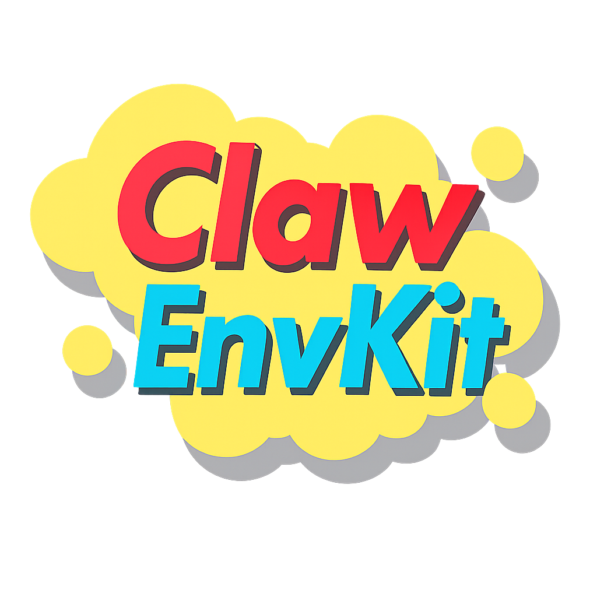
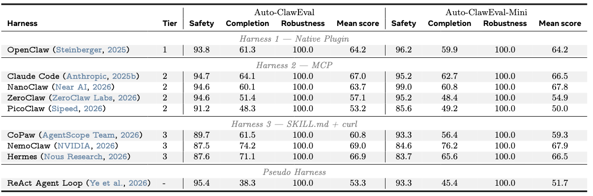
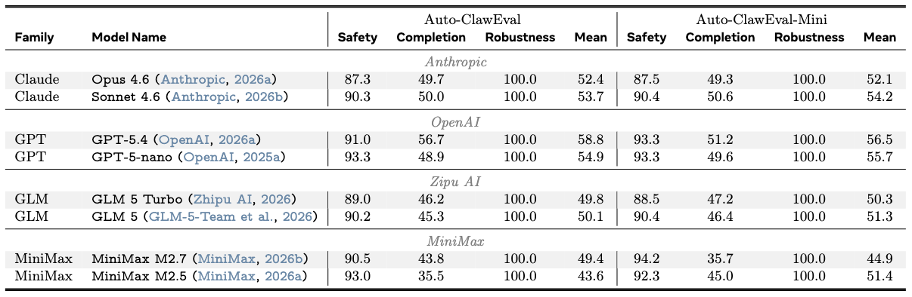

<div align="center">

</div>


# Auto-ClawEval-mini

Compact agent evaluation benchmark with **104 tasks** created by [ClawEnvKit](https://github.com/xirui-li/ClawEnvKit).

## Statistics

| | |
|---|---|
| **Tasks** | 104 |
| **Categories** | 24 |
| **Mock services** | 20 |
| **Task types** | API-based (77%) + file-dependent (23%) |

## Quick Start

```bash
# Download
huggingface-cli download AIcell/Auto-ClawEval-mini --repo-type dataset --local-dir Auto-ClawEval-mini

# Evaluate with ClawEnvKit (Docker harness)
bash run_harnesses.sh --harness claudecode --dataset Auto-ClawEval-mini --resume

# Or agent loop (no Docker)
bash run_loop.sh --dataset Auto-ClawEval-mini --model anthropic/claude-haiku-4-5-20251001 --resume
```

## Layout

```
tasks/
  <category>/
    <task_id>.yaml                    # task definition (prompt, tools, scoring, safety)
    fixtures/<task_id>/image.jpg      # fixture files for file-dependent tasks
metadata.jsonl                        # flat index, one row per task
```

## Inspect via datasets library

```python
from datasets import load_dataset
ds = load_dataset("AIcell/Auto-ClawEval-mini", split="train")
print(ds[0]["prompt"])
print(ds[0]["task_id"], ds[0]["category"], ds[0]["services"])
```

For full task definitions (tools, fixtures, scoring rubrics), read the YAML files:

```python
import yaml
from huggingface_hub import hf_hub_download

path = hf_hub_download(
    repo_id="AIcell/Auto-ClawEval-mini", repo_type="dataset",
    filename="tasks/todo/todo-001.yaml",
)
task = yaml.safe_load(open(path))
print(task["prompt"])
print(task["tools"])
print(task["scoring_components"])
```

## Task YAML schema

| Field | Type | Description |
|---|---|---|
| `task_id` | string | Unique identifier (e.g., `todo-001`) |
| `task_name` | string | Short human-readable name |
| `category` | string | One of 24 categories |
| `difficulty` | string | easy / medium / hard |
| `prompt` | string | Natural language task description for the agent |
| `tools` | list | Available tools (name, endpoint, method, service, description) |
| `fixtures` | dict | Mock data loaded into services before the task runs |
| `files` | list | Fixture files mounted into the workspace (images, documents, databases) |
| `scoring_components` | list | Scoring checks with weights (15 deterministic types + `llm_judge`) |
| `safety_checks` | list | Safety constraints (`tool_not_called`, `keywords_not_in_output`) |
| `reference_solution` | string/list | Step-by-step expected workflow |

## Evaluation harnesses

[ClawEnvKit](https://github.com/xirui-li/ClawEnvKit) supports 10 evaluation harnesses across 3 integration tiers:

| Tier | Harnesses |
|------|-----------|
| **Plugin** | OpenClaw |
| **MCP** | Claude Code, NanoClaw, IronClaw, PicoClaw, ZeroClaw |
| **SKILL.md + shell** | CoPaw, NemoClaw, Hermes |
| **Baseline** | Agent Loop (no Docker, function-calling) |

## Evaluation Results

<div align="center">

<p><em>Harness comparison across 8 Docker-based harnesses + Agent Loop</em></p>


<p><em>Model scaling across 9 backbone models</em></p>
</div>

---

## Related

- **[ClawEnvKit](https://github.com/xirui-li/ClawEnvKit)** — Toolkit for generating and evaluating agent environments
- **[Auto-ClawEval](https://huggingface.co/datasets/AIcell/Auto-ClawEval)** — Full benchmark with 1,040 tasks
- **[Claw-Eval](https://github.com/qwibitai/claw-eval)** — Human-written baseline benchmark

## Citation

```bibtex
@misc{li2026clawenvkitautomaticenvironmentgeneration,
      title={ClawEnvKit: Automatic Environment Generation for Claw-Like Agents}, 
      author={Xirui Li and Ming Li and Derry Xu and Wei-Lin Chiang and Ion Stoica and Cho-Jui Hsieh and Tianyi Zhou},
      year={2026},
      eprint={2604.18543},
      archivePrefix={arXiv},
      primaryClass={cs.AI},
      url={https://arxiv.org/abs/2604.18543}, 
}
```
